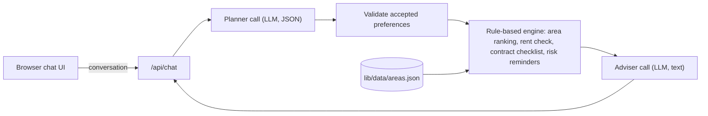

# HomeFit SG

A conversational rental advisor for people moving to Singapore. You describe your situation in plain language (where you study or work, your budget, how far you are willing to travel), and the assistant asks follow-up questions, recommends areas that fit, compares them, checks a rent you were quoted, and reviews a tenancy agreement you paste in.

This is a course prototype for CS5224 Cloud Computing. **All area data are demo estimates**, not live listings, market prices or measured routes.

## Features

- **Conversation first.** The assistant clarifies vague requests (for example, what "close to campus" means) before recommending anything.
- **Area recommendations.** 44 areas across Singapore and 10 destinations (NUS Kent Ridge, NTU, SMU, Raffles Place, Changi Business Park, one-north, SUTD, SIT Punggol, Jurong Lake District, Changi Airport). Up to 5 areas are shown, each with rent, commute time and trade-offs.
- **Side-by-side comparison** of two or three recommended areas.
- **Rent check.** Compares a rent you were quoted with the demo reference for that area.
- **Contract check.** Paste a tenancy agreement and get a checklist of key terms that are present or missing (deposit refund, early termination, repairs, utilities and more), plus phrases worth asking about (non-refundable fees, entry without notice and similar). It is a keyword checklist, not legal advice.
- **Risk reminders** before viewing, paying or signing.
- Replies in the language of the user's message (English by default).

## How it works



1. **Planner.** The model reads the whole conversation and returns a small JSON plan: the preferences the user has actually accepted (budget, destination, maximum commute, room type, priority), whether to show recommendations, and any rent the user quoted. Suggestions the assistant made are never treated as accepted.
2. **Validation.** The plan is checked against a whitelist (`lib/conversation.ts`, `lib/preferences.ts`). Unknown fields and out-of-range values are rejected.
3. **Rule-based engine.** Numbers come only from code and the local dataset, never from the model.
   - `lib/recommend.ts` applies the budget and commute limits as hard filters, then ranks the remaining areas by budget headroom, commute headroom, quietness and amenities, weighted by the user's priority.
   - `lib/rent-check.ts` compares a quoted rent with the area's demo reference.
   - `lib/contract-review.ts` runs the contract checklist.
   - `lib/risks.ts` picks the relevant reminders.
4. **Adviser.** A second model call writes the reply from these facts (the "evidence"). The prompt forbids inventing prices, routes, listings or legal claims.
5. **Panels.** Recommendations, comparisons, rent checks and contract checks are shown as folded panels under the reply.

The model is called through any OpenAI-compatible Chat Completions API (`lib/llm-config.ts`). The API key stays on the server.

## Data

`lib/data/areas.json` holds one record per area: common-room rent (S$ per month), commute estimates to each destination, quiet and amenity scores (1 to 5) and a short trade-off note. Every record carries `room_type`, `currency`, `period`, `source`, `as_of` and `is_demo: true`.

The first 14 areas were estimated by hand. The other 30 areas, and the commute times to the five newer destinations, come from a simple distance model fitted to those hand estimates (about 4 minutes RMSE). Treat every number as illustrative.

## Project layout

```
app/                 Next.js App Router: page, layout, styles, /api/chat and /api/health
components/          Chat UI, comparison dialog and table
lib/                 Conversation logic, validation, ranking, rent and contract checks, LLM config
lib/data/areas.json  Demo dataset
tests/               Unit tests (Vitest) and browser tests (Playwright)
scripts/             Local setup helpers (write .env.local, check the API key)
deploy/              AWS Lambda build, deploy and cleanup scripts
Dockerfile           Container image for other hosts
```

## Run locally

Requires Node.js 20.9 or later.

```bash
npm ci
npm run setup       # asks for your model API key and writes .env.local (git-ignored)
npm run check-ai    # optional: one tiny request to confirm the key works
npm run dev         # http://localhost:3000
```

Without a key, the page still loads, and the chat explains that AI is not connected. See `.env.example` for all settings.

| Variable | Required | Purpose |
| --- | --- | --- |
| `LLM_API_KEY` | yes | Key for the model provider (server-only) |
| `LLM_BASE_URL` | no | OpenAI-compatible endpoint (default `https://zenmux.ai/api/v1`) |
| `LLM_MODEL` | no | Model name (default `deepseek/deepseek-v4.1-flash`) |
| `LLM_MAX_TOKENS` | no | Output budget per call (default 2000 for planning, 1600 for replies) |
| `LLM_EXTRA_BODY` | no | Extra request fields as a JSON object, e.g. `{"reasoning_effort":"low"}` |

## Tests

```bash
npm run typecheck
npm test            # unit tests, no model calls
npm run build
npx playwright install chromium   # once, for the browser tests
npm run test:e2e    # desktop and phone sizes; run after npm run build (the model API is mocked)
```

## Deploy to AWS Lambda

The app runs as one Lambda function behind a public function URL. The [AWS Lambda Web Adapter](https://github.com/awslabs/aws-lambda-web-adapter) layer forwards HTTP requests to the Next.js server. Nothing runs while nobody uses the site, so idle cost is zero.

In AWS CloudShell (or any shell with the AWS CLI, Node.js 20.9+ and zip):

```bash
git clone https://github.com/<your-account>/homefit-sg.git && cd homefit-sg
bash deploy/build-lambda.sh   # builds deploy/lambda.zip
bash deploy/deploy.sh         # asks for the API key (input hidden) and prints the site URL
```

`deploy.sh` creates or updates:

- the IAM role `homefit-sg-demo-role` (log writing only)
- the Lambda function `homefit-sg-demo` (Node.js 22, 1 GB, 90 s timeout, at most 20 concurrent requests)
- a public HTTPS function URL
- a log group kept for 7 days

Run it again after changes: it updates the code, keeps the URL, the key and the model settings, and asks for a new key only if you type one. For a first deploy, it defaults to MiniMax-M3.1-Flash. Override any setting when running it, for example `LLM_MODEL=MiniMax-M3 LLM_EXTRA_BODY='{}' bash deploy/deploy.sh`. To remove everything it created, run `bash deploy/cleanup.sh`.

The `Dockerfile` builds the same standalone server as a container for hosts such as ECS, Cloud Run or Azure Container Apps. Pass the `LLM_*` variables as secrets at run time.

## Limitations

- Demo data only: no live listings, real market prices or measured routes. Only common rooms are covered.
- The contract check matches keywords. It cannot tell whether a clause is fair, standard or enforceable.
- Replies depend on the external model and take a few seconds. If the model returns unusable output, the conversation is kept and the user can retry.
- No accounts, payments or database. Conversations are not saved; error logs may keep a short sample of unusable model output.

## AI use

The app calls an external large language model at runtime, as described above. AI coding assistants were also used during development; see the project report for the course's AI usage declaration.
